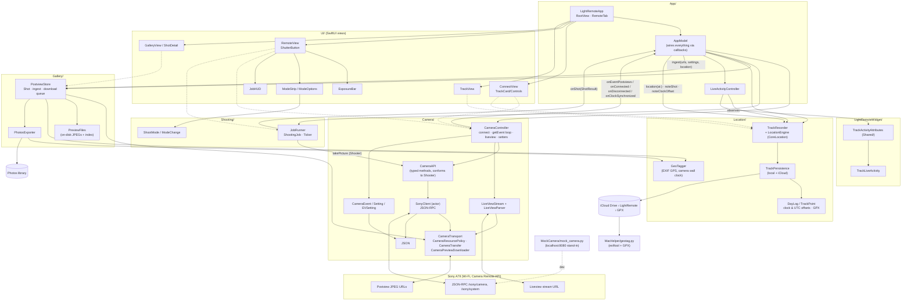

# LightRemote architecture

## Notes

- **`AppModel` is the only hub.** `CameraController`, `JobRunner`, `PostviewStore` and `TrackRecorder` never reference each other. `AppModel` connects them through closure callbacks such as `onShot`, `onEventPostviews` and `onConnected`.
- **Every camera call goes through `CameraTransport`.** JSON-RPC, liveview and postview downloads all pass through `CameraResourcePolicy` and `CameraTransfer`, so they share the same host checks and size limits.
- **A shot follows one path:** `JobRunner` → `ShotResult` → `AppModel`. `AppModel` looks up the GPS point from `TrackRecorder`, then `PostviewStore` downloads and stores the preview. When the shot's timing is reliable, the camera clock read from the JPEG's EXIF goes back to `TrackRecorder` as a clock offset.
- **Geotagging the full-size files happens off the phone.** The GPX tracks sync through iCloud, and `MacHelper/geotag.py` uses them to tag the RAW and JPEG files from the SD card.
